<!-- ════════════════════════════  🎀  HEADER  🎀  ════════════════════════════ -->

  

  

  
  

<!-- ════════════════════════════  🎀  ABOUT ME  🎀  ═══════════════════════════ -->

  

### 🎀 Hi there, I'm Syakira!

- 🌸 &nbsp;A web developer who loves building **neat, pretty & useful** apps
- 💻 &nbsp;Mostly crafting with **Laravel, PHP & Blade**
- 🌷 &nbsp;Exploring **TypeScript** and **data science with Python & Streamlit**
- 💄 &nbsp;Currently building **a cosmetics web app** with Laravel
- 📚 &nbsp;Always learning, one commit at a time
- 💌 &nbsp;Happy to chat about web dev, UI design, or anything pink!

> *"Write code the way you tie a ribbon: neat, careful, and with a little love."* 🎀

 

<!-- ════════════════════════════  🎀  TECH STACK  🎀  ═════════════════════════ -->

  

<b>🎀 &nbsp; L A N G U A G E S &nbsp; 🎀</b>

  
  
  
  
  
  

<b>🎀 &nbsp; F R A M E W O R K S &nbsp; & &nbsp; L I B R A R I E S &nbsp; 🎀</b>

  
  
  
  
  
  

<b>🎀 &nbsp; D A T A B A S E &nbsp; & &nbsp; T O O L S &nbsp; 🎀</b>

  
  
  
  
  
  
  

<!-- ════════════════════════════  🎀  GITHUB STATS  🎀  ═══════════════════════ -->

  

  
  

  

<!-- Ular pink ini dibuat otomatis oleh .github/workflows/pink-snake.yml -->

  <picture>
    <source media="(prefers-color-scheme: dark)" srcset="https://raw.githubusercontent.com/syakirafara/syakirafara/output/pink-snake-dark.svg" />
    
  </picture>

<!-- ════════════════════════════  🎀  LET'S CONNECT  🎀  ══════════════════════ -->

  

<!-- GANTI link LinkedIn, Instagram & email di bawah dengan punyamu (atau hapus yang tidak dipakai) -->

  
  
  

<!-- ════════════════════════════  🎀  FOOTER  🎀  ═════════════════════════════ -->

  

