  

  

  Hi, I'm <b>Syakira</b>, a website developer who enjoys building 
  clean, useful, and thoughtfully designed websites.

  I love learning new things and turning ideas into something real. 
  Always learning, one commit at a time.

 

  

  
  
  
  
   
  
  
  
  

 

  

  
  

<!-- Ular pink ini dibuat otomatis oleh .github/workflows/pink-snake.yml -->

  <picture>
    <source media="(prefers-color-scheme: dark)" srcset="https://raw.githubusercontent.com/syakirafara/syakirafara/output/pink-snake-dark.svg" />
    
  </picture>

 

  

  
  
  

 

  

